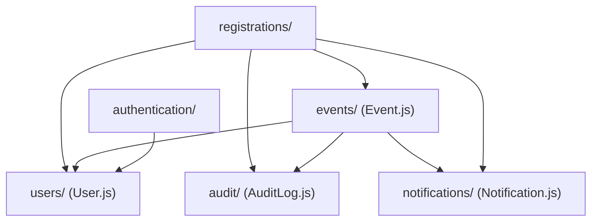

# Modules Directory Documentation (`server/src/modules`)

## A. Directory Overview
The `server/src/modules` directory forms the domain heart of the Eventora application. Designed according to Vertical Slice Architecture principles, each feature directory represents a self-contained domain capability encapsulating its own data schemas, HTTP routing, business services, and controllers, minimizing coupling across business features.

## B. Directory Structure
```text
server/src/modules/
├── modules.md           # This documentation file
├── audit/               # Immutable compliance audit log records
│   ├── audit.md         # Audit documentation
│   └── AuditLog.js
├── authentication/      # Session-based auth, registration, login, logout, and CSRF distribution
│   ├── authentication.md # Authentication documentation
│   ├── authController.js
│   ├── authRoutes.js
│   └── authService.js
├── events/              # Event lifecycle, browsing, capacity floors, and Cloudinary uploads
│   ├── events.md        # Events documentation
│   ├── Event.js
│   ├── eventController.js
│   ├── eventRoutes.js
│   └── eventService.js
├── notifications/       # In-app alerts and notifications feed
│   ├── notifications.md # Notifications documentation
│   ├── Notification.js
│   ├── notificationController.js
│   ├── notificationRoutes.js
│   └── notificationService.js
├── registrations/       # Atomic seat allocation, RSVPs, and cancellation approval workflow
│   ├── registrations.md # Registrations documentation
│   ├── Registration.js
│   ├── registrationController.js
│   ├── registrationRoutes.js
│   └── registrationService.js
└── users/               # User account entity, immutable roles, and password suppression
    ├── users.md         # Users documentation
    └── User.js
```

## C. File-by-File Documentation
There are no direct source files in `server/src/modules/`; all domain logic is divided into the 6 feature subdirectories documented below.

## D. Child Directory Documentation

1. **[`audit/`](audit/audit.md)**
   - **Responsibility:** Immutable forensic audit logs (`AuditLog.js`) recording critical state transitions and security events.
   - **Documentation:** [`server/src/modules/audit/audit.md`](audit/audit.md)

2. **[`authentication/`](authentication/authentication.md)**
   - **Responsibility:** User registration, password verification, session fixation defense, and CSRF token management.
   - **Documentation:** [`server/src/modules/authentication/authentication.md`](authentication/authentication.md)

3. **[`events/`](events/events.md)**
   - **Responsibility:** Event creation, search, detail retrieval, capacity floor guards, attendee rosters, and backend-only Cloudinary banner uploads.
   - **Documentation:** [`server/src/modules/events/events.md`](events/events.md)

4. **[`notifications/`](notifications/notifications.md)**
   - **Responsibility:** In-app notification creation, unread count polling, and mark-as-read state transitions.
   - **Documentation:** [`server/src/modules/notifications/notifications.md`](notifications/notifications.md)

5. **[`registrations/`](registrations/registrations.md)**
   - **Responsibility:** Atomic capacity management via conditional MongoDB updates, duplicate RSVP prevention, cancellation requests/approvals, and Resend email triggers.
   - **Documentation:** [`server/src/modules/registrations/registrations.md`](registrations/registrations.md)

6. **[`users/`](users/users.md)**
   - **Responsibility:** User schema, role immutability (`ATTENDEE`, `ORGANIZER`), email normalization, and password hash security.
   - **Documentation:** [`server/src/modules/users/users.md`](users/users.md)

## E. Internal Relationships


## F. Execution Flow
Incoming requests are dispatched by Express to the respective module's router:
- `/api/v1/auth` -> `authentication/authRoutes.js`
- `/api/v1/events` -> `events/eventRoutes.js`
- `/api/v1/notifications` -> `notifications/notificationRoutes.js`
- `/api/v1` (registrations/cancellations) -> `registrations/registrationRoutes.js`

## G. External Dependencies and Integrations
- `mongoose`: Data modeling and atomic operations.
- `infrastructure/`: Logging, database, email, session, and Cloudinary clients.
- `shared/`: Middleware, validation schemas, errors, and constants.

## H. Important Implementation Notes
- **Modular Boundaries:** Cross-module communication is performed via exported service functions rather than direct database manipulation across domains, preserving high cohesion and low coupling.

## I. Related Documentation
- [Server Source Root (`server/src/src.md`)](../src.md)
- [Server Root Documentation (`server/server_root.md`)](../../server_root.md)

