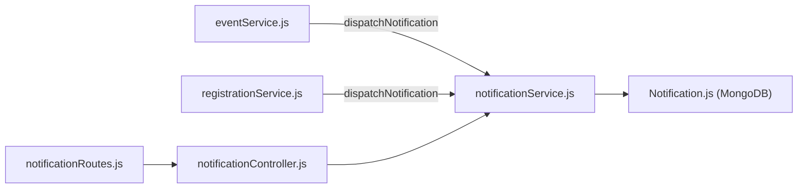

# Notifications Module Documentation (`server/src/modules/notifications`)

## A. Directory Overview
The `server/src/modules/notifications` directory manages in-app alert notifications for Eventora users. Whenever an event is cancelled, a booking is confirmed, or a cancellation request is submitted or reviewed, this module records structured in-app notification records and powers the real-time notification bell and alert feed in the frontend interface.

## B. Directory Structure
```text
server/src/modules/notifications/
├── notifications.md           # This documentation file
├── Notification.js            # Mongoose model and schema for in-app alerts
├── notificationController.js  # HTTP handlers for fetching and marking notifications read
├── notificationRoutes.js      # Express router for authenticated notification endpoints
└── notificationService.js     # Dispatching, querying, and read-state management
```

## C. File-by-File Documentation

### 1. `Notification.js`
- **File Type:** JavaScript Module (ESM)
- **Primary Responsibility:** Mongoose schema for the `notifications` collection.
- **Exported Symbols:**
  - `Notification`: Mongoose model.
- **Schema Fields:**
  - `userId`: ObjectId (ref: `User`, required, indexed). Recipient user ID.
  - `type`: String (enum: `NOTIFICATION_TYPE`, required, indexed) — e.g., `BOOKING_CONFIRMED`, `CANCELLATION_REQUESTED`, `EVENT_CANCELLED`.
  - `channel`: String (enum: `NOTIFICATION_CHANNEL`, default: `IN_APP`, indexed).
  - `title`: String (required, trimmed).
  - `message`: String (required, trimmed).
  - `eventId`: ObjectId (ref: `Event`, default: `null`).
  - `registrationId`: ObjectId (ref: `Registration`, default: `null`).
  - `status`: String (`SENT`, `DELIVERED`, `FAILED`, `SKIPPED`, default: `DELIVERED`).
  - `isRead`: Boolean (default: `false`, indexed).
- **Compound Indexes:** `{ userId: 1, isRead: 1, createdAt: -1 }`, `{ userId: 1, createdAt: -1 }`.

### 2. `notificationController.js`
- **File Type:** JavaScript Module (ESM)
- **Primary Responsibility:** HTTP request handler for notification actions.
- **Exported Handlers:**
  - `getMyNotifications(req, res, next)`: Retrieves paginated notifications and unread badge count for authenticated user (200 OK).
  - `markAsRead(req, res, next)`: Marks single notification as read (200 OK).
  - `markAllAsRead(req, res, next)`: Marks all notifications read for user (200 OK).

### 3. `notificationRoutes.js`
- **File Type:** JavaScript Module (ESM)
- **Primary Responsibility:** Express router mounted at `/api/v1/notifications`.
- **Endpoints:**
  - `GET /`: `requireAuth` -> `getMyNotifications`.
  - `PATCH /:notificationId/read`: `requireAuth`, `csrfProtection` -> `markAsRead`.
  - `PATCH /read-all`: `requireAuth`, `csrfProtection` -> `markAllAsRead`.

### 4. `notificationService.js`
- **File Type:** JavaScript Module (ESM)
- **Primary Responsibility:** Business logic for dispatching and reading in-app notifications.
- **Exported Functions:**
  - `dispatchNotification({ userId, type, channel, title, message, eventId, registrationId })`: Creates a new `Notification` document. Non-blocking error handling ensures domain flows are not interrupted by notification errors.
  - `getUserNotifications(userId, { page, limit, unreadOnly })`: Fetches user notifications sorted newest-first and counts unread records.
  - `markNotificationAsRead(notificationId, userId)`: Sets `isRead: true` for owned notification.
  - `markAllNotificationsAsRead(userId)`: Batch updates all user's notifications to `isRead: true`.

## D. Child Directory Documentation
No child subdirectories exist in this directory.

## E. Internal Relationships


## F. Execution Flow
1. Core events (e.g., event cancelled, ticket booked) call `dispatchNotification()`.
2. Document is saved to `notifications` collection.
3. User logs in; frontend `NotificationBell` polls `GET /api/v1/notifications` displaying unread count and popover list.
4. User clicks an item or "Mark all as read", triggering `PATCH /read-all`.

## G. External Dependencies and Integrations
- `mongoose`: Data persistence.

## H. Important Implementation Notes
- **Privacy Isolation:** Queries strictly include `userId: req.user.id`, preventing cross-account notification snooping.

## I. Related Documentation
- [Modules Parent Directory (`server/src/modules/modules.md`)](../modules.md)
- [Server Root Documentation (`server/server_root.md`)](../../../server_root.md)

