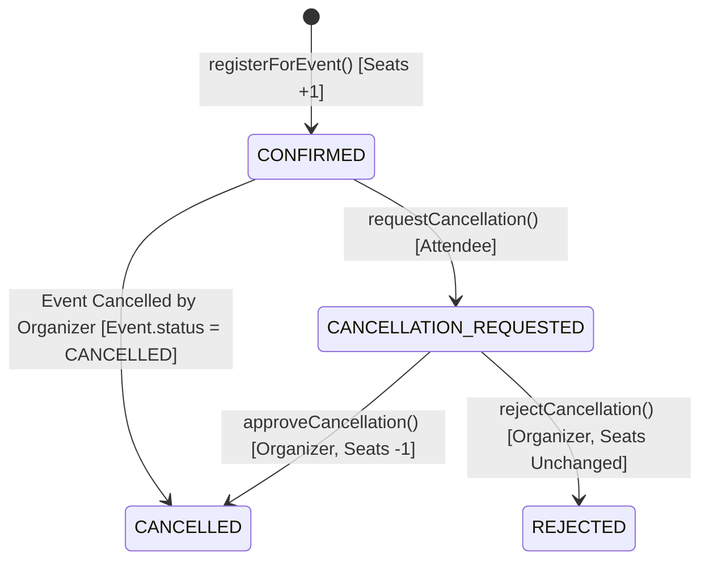

# Registrations Module Documentation (`server/src/modules/registrations`)

## A. Directory Overview
The `server/src/modules/registrations` directory coordinates event ticket bookings (RSVPs) and the attendee cancellation approval workflow. It is the core transactional engine of Eventora, providing mathematical immunity against overbooking using conditional atomic MongoDB expressions, unique compound indexing against duplicate RSVPs, and asynchronous dispatching of Resend confirmation emails.

## B. Directory Structure
```text
server/src/modules/registrations/
├── registrations.md           # This documentation file
├── Registration.js            # Mongoose schema, status state machine, compound unique indexes
├── registrationController.js  # HTTP handlers for attendee bookings and organizer decisions
├── registrationRoutes.js      # Endpoint definitions, rate limits, and RBAC guards
└── registrationService.js     # Atomic capacity control, rollback resilience, email integration
```

## C. File-by-File Documentation

### 1. `Registration.js`
- **File Type:** JavaScript Module (ESM)
- **Primary Responsibility:** Mongoose schema for the `registrations` collection.
- **Exported Symbols:**
  - `Registration`: Mongoose model.
- **Schema Fields:**
  - `eventId`: ObjectId (ref: `Event`, required, indexed).
  - `attendeeId`: ObjectId (ref: `User`, required, indexed).
  - `status`: String (enum: `CONFIRMED`, `CANCELLATION_REQUESTED`, `CANCELLED`, `REJECTED`, default: `CONFIRMED`, indexed).
  - `cancellationReason`: String (max 500 chars).
  - `decisionNote`: String (max 500 chars).
  - `decidedBy`: ObjectId (ref: `User`).
  - `decidedAt`: Date.
  - `confirmationEmailSent`: Boolean (default: `false`). Guard flag for email deduplication.
- **Compound Unique Index:**
  - `{ eventId: 1, attendeeId: 1 }` with `unique: true`.
  - **Guarantee:** An attendee can physically never have more than one active registration record for a single event in MongoDB.

### 2. `registrationController.js`
- **File Type:** JavaScript Module (ESM)
- **Primary Responsibility:** Translates HTTP requests into registration domain actions.
- **Exported Handlers:**
  - `registerForEvent(req, res, next)`: `POST /events/:eventId/registrations` (201 Created).
  - `getMyRegistrations(req, res, next)`: `GET /registrations/me` (200 OK).
  - `requestCancellation(req, res, next)`: `POST /registrations/:registrationId/cancellation-request` (200 OK).
  - `getOrganizerCancellationRequests(req, res, next)`: `GET /organizer/cancellation-requests` (200 OK).
  - `approveCancellation(req, res, next)`: `POST /cancellation-requests/:requestId/approve` (200 OK).
  - `rejectCancellation(req, res, next)`: `POST /cancellation-requests/:requestId/reject` (200 OK).

### 3. `registrationRoutes.js`
- **File Type:** JavaScript Module (ESM)
- **Primary Responsibility:** Express router mounting registration and cancellation routes.
- **Protected Endpoints:**
  - `POST /events/:eventId/registrations`: `requireAuth`, `requireAttendee`, `registerEventRateLimiter` (30 req / 15m), `csrfProtection`.
  - `GET /registrations/me`: `requireAuth`, `requireAttendee`.
  - `POST /registrations/:registrationId/cancellation-request`: `requireAuth`, `requireAttendee`, `csrfProtection`.
  - `GET /organizer/cancellation-requests`: `requireAuth`, `requireOrganizer`.
  - `POST /cancellation-requests/:requestId/approve`: `requireAuth`, `requireOrganizer`, `csrfProtection`.
  - `POST /cancellation-requests/:requestId/reject`: `requireAuth`, `requireOrganizer`, `csrfProtection`.

### 4. `registrationService.js`
- **File Type:** JavaScript Module (ESM)
- **Primary Responsibility:** Transactional concurrency control and business logic.
- **Exported Functions:**
  - `registerForEvent({ eventId, attendeeId, ipAddress, userAgent })`:
    1. Validates event existence, status (`PUBLISHED`), and future date (`eventDate > Date.now()`).
    2. Executes conditional atomic seat increment:
       ```javascript
       Event.findOneAndUpdate(
         {
           _id: eventId,
           status: 'PUBLISHED',
           eventDate: { $gt: new Date() },
           $expr: { $lt: ['$seatsBooked', '$seatLimit'] }
         },
         { $inc: { seatsBooked: 1 } },
         { new: true }
       )
       ```
    3. If query returns null, throws `BadRequestError('Event is sold out. No seats remaining.')`.
    4. Inserts `Registration` document. If duplicate key error `11000` occurs, rolls back the incremented seat and throws `ConflictError('You are already registered for this event.')`.
    5. Dispatches non-blocking confirmation email via `sendRegistrationConfirmationEmail`.
  - `requestCancellation({ registrationId, attendeeId, reason })`: Enforces ticket ownership; transitions status to `CANCELLATION_REQUESTED`; notifies organizer.
  - `approveCancellation({ requestId, organizerId, decisionNote })`: Enforces event ownership; transitions status to `CANCELLED`; atomically decrements `Event.seatsBooked` by 1; notifies attendee.
  - `rejectCancellation({ requestId, organizerId, decisionNote })`: Transitions status to `REJECTED`; seats remain occupied; notifies attendee.

## D. Child Directory Documentation
No child subdirectories exist in this directory.

## E. Internal Relationships


## F. Execution Flow
Attendee clicks RSVP -> `registrationRoutes` validates CSRF & role -> `registerForEvent` executes atomic `$inc` with `$expr: { $lt: ['$seatsBooked', '$seatLimit'] }` -> Creates registration record -> Triggers Resend email async -> Returns 201 Created.

## G. External Dependencies and Integrations
- `mongoose`: Atomic operations and unique indexing.
- `emailService`: Transactional confirmation email dispatch.
- `notificationService`: In-app notification creation.

## H. Important Implementation Notes
- **Zero Race Conditions:** The atomic MongoDB query operates at the database document lock level. Even under thousands of concurrent requests competing for the last remaining seat, exactly one request succeeds and all others receive `400 Bad Request (Sold Out)`.

## I. Related Documentation
- [Modules Parent Directory (`server/src/modules/modules.md`)](../modules.md)
- [Email Service (`server/src/infrastructure/email/email.md`)](../../infrastructure/email/email.md)
- [Server Root Documentation (`server/server_root.md`)](../../../server_root.md)

