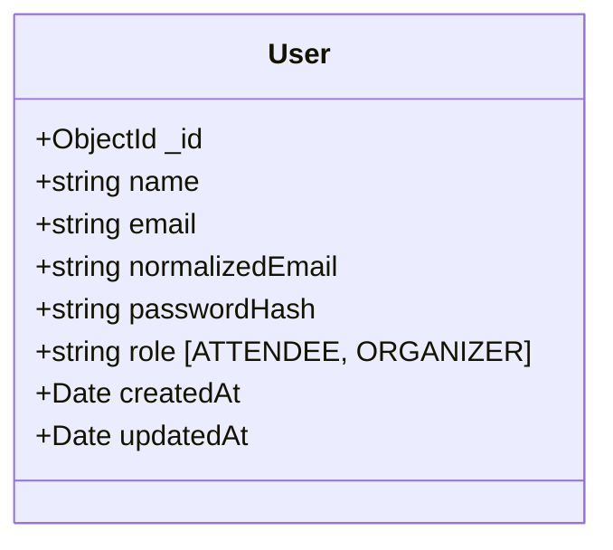

# Users Module Documentation (`server/src/modules/users`)

## A. Directory Overview
The `server/src/modules/users` directory defines the user entity model for the Eventora platform. It encapsulates account attributes, role immutability, email normalization constraints, and automated password hash suppression in API serialization.

## B. Directory Structure
```text
server/src/modules/users/
├── users.md             # This documentation file
└── User.js              # Mongoose model and schema for system users
```

## C. File-by-File Documentation

### 1. `User.js`
- **File Type:** JavaScript Module (ESM)
- **Primary Responsibility:** Defines Mongoose schema and model for authenticated actors.
- **Exported Symbols:**
  - `User`: Mongoose model mapped to `users` collection.
- **Dependencies:** `mongoose`, `ROLES`, `ALL_ROLES` from `../../shared/constants/roles.js`.
- **Used By:** `authService.js`, `eventService.js`, `registrationService.js`, `seed.js`.
- **Schema Fields:**
  - `name`: String (2–100 chars, trimmed).
  - `email`: String (trimmed, lowercase, max 255 chars).
  - `normalizedEmail`: String (unique index, trimmed, lowercase). Used for case-insensitive login deduplication.
  - `passwordHash`: String (Argon2id hash, `select: false` so it is omitted from queries unless explicitly requested via `.select('+passwordHash')`).
  - `role`: String (enum: `ATTENDEE` or `ORGANIZER`, `immutable: true`). Role cannot be altered via update operations once set.
- **Serialization Sanitization:** Custom `toJSON` and `toObject` transforms permanently delete `passwordHash` and `__v` from API output.

## D. Child Directory Documentation
No child subdirectories exist in this directory.

## E. Internal Relationships


## F. Execution Flow
Queried by `authService` during login, instantiated during registration, and referenced by `Event.organizerId` and `Registration.attendeeId`.

## G. External Dependencies and Integrations
- `mongoose`: Data modeling.

## H. Important Implementation Notes
- **Role Immutability:** Mongoose schema option `immutable: true` on `role` prevents unauthorized privilege escalation through user profile updates.

## I. Related Documentation
- [Modules Parent Directory (`server/src/modules/modules.md`)](../modules.md)
- [Authentication Module (`server/src/modules/authentication/authentication.md`)](../authentication/authentication.md)
- [Server Root Documentation (`server/server_root.md`)](../../../server_root.md)

