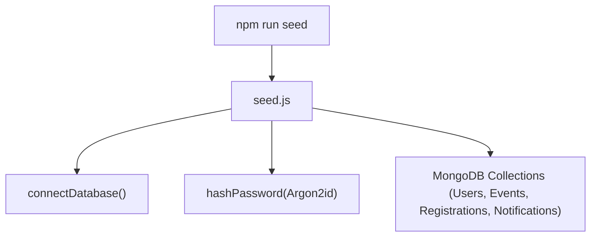

# Scripts Directory Documentation (`server/src/scripts`)

## A. Directory Overview
The `server/src/scripts` directory houses operational and developer utilities for database initialization, development data seeding, and test environment provisioning.

## B. Directory Structure
```text
server/src/scripts/
├── scripts.md           # This documentation file
└── seed.js              # Database reset and demo account / sample event seeder
```

## C. File-by-File Documentation

### 1. `seed.js`
- **File Type:** JavaScript Module (ESM) / Node.js CLI script
- **Primary Responsibility:** Wipes development database and provisions deterministic demo accounts and sample events.
- **Exported Symbols:**
  - `seedDatabase()`: Asynchronous execution function.
- **Dependencies:** `mongoose`, `dotenv`, `User`, `Event`, `Registration`, `Notification`, `password.js`, `connection.js`.
- **Used By:** `npm run seed --prefix server`, `npm run seed` (root), test setup scripts.
- **Implementation Logic:**
  - Connects to target MongoDB instance (`MONGODB_URI`).
  - Clears `users`, `events`, `registrations`, and `notifications` collections.
  - Seeds Demo Accounts with Argon2id hashed passwords:
    - **Organizer:** `organizer@eventora.demo` / `Organizer@123`
    - **Attendee:** `attendee@eventora.demo` / `Attendee@123`
    - **Second Attendee:** `marcus@eventora.demo` / `Attendee@123`
  - Creates 4 sample events across tech, design, AI, and sustainability with realistic descriptions, dates, and seat limits.
  - Provisions initial confirmed registrations and in-app notifications.
  - Disconnects database cleanly and prints credentials table to terminal.

## D. Child Directory Documentation
No child subdirectories exist in this directory.

## E. Internal Relationships


## F. Execution Flow
Invoked manually via terminal `npm run seed` or in CI workflows to establish a known state before test runs.

## G. External Dependencies and Integrations
- `mongoose`: Collection wipes and batch inserts.
- `dotenv`: Local environment configuration.

## H. Important Implementation Notes
- **Safety:** Always run against development or staging databases; never execute against live production customer data without explicit intention.

## I. Related Documentation
- [Server Source Root (`server/src/src.md`)](../src.md)
- [Server Root Documentation (`server/server_root.md`)](../../server_root.md)

