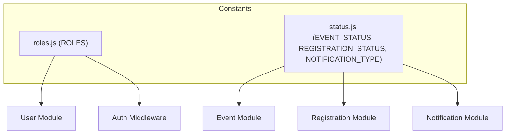

# Constants Directory Documentation (`server/src/shared/constants`)

## A. Directory Overview
The `server/src/shared/constants` directory houses domain-wide immutable enumerations and status objects used across the backend application. As part of the Shared Kernel, these definitions establish a single source of truth for authorization roles, lifecycle states, and notification event types, eliminating magic strings across models, validation schemas, controllers, and services.

## B. Directory Structure
```text
server/src/shared/constants/
├── constants.md         # This documentation file
├── roles.js             # User role enumerations (ATTENDEE, ORGANIZER)
└── status.js            # Lifecycle states for events, registrations, and notifications
```

## C. File-by-File Documentation

### 1. `roles.js`
- **File Type:** JavaScript Module (ESM)
- **Primary Responsibility:** Defines immutable user authorization roles.
- **Exported Symbols:**
  - `ROLES`: Frozen object containing `ATTENDEE: 'ATTENDEE'` and `ORGANIZER: 'ORGANIZER'`.
  - `ALL_ROLES`: Array of strings (`['ATTENDEE', 'ORGANIZER']`).
- **Dependencies:** None.
- **Used By:** `User.js`, `authValidation.js`, `authMiddleware.js`, `authService.js`, `seed.js`.
- **Implementation Logic:** Employs `Object.freeze()` to prevent runtime tampering with role constants.
- **Security Considerations:** Secures RBAC policies. Roles are strictly bounded to prevent privilege escalation.

### 2. `status.js`
- **File Type:** JavaScript Module (ESM)
- **Primary Responsibility:** Defines domain state machines for events, registrations, and notification types.
- **Exported Symbols:**
  - `EVENT_STATUS`: `DRAFT`, `PUBLISHED`, `CANCELLED`.
  - `REGISTRATION_STATUS`: `CONFIRMED`, `CANCELLATION_REQUESTED`, `CANCELLED`, `REJECTED`.
  - `NOTIFICATION_TYPE`: `BOOKING_CONFIRMED`, `CANCELLATION_REQUESTED`, `CANCELLATION_APPROVED`, `CANCELLATION_REJECTED`, `EVENT_CANCELLED`.
  - `NOTIFICATION_CHANNEL`: `IN_APP`, `EMAIL`.
- **Dependencies:** None.
- **Used By:** `Event.js`, `Registration.js`, `Notification.js`, `eventService.js`, `registrationService.js`, `notificationService.js`, `eventValidation.js`.
- **Implementation Logic:** Pure frozen constants representing exact states in database documents.

## D. Child Directory Documentation
No child subdirectories exist in this directory.

## E. Internal Relationships


## F. Execution Flow
Constants are imported synchronously at module evaluation time when controllers, middleware, or Mongoose models are loaded into the Node.js process.

## G. External Dependencies and Integrations
Uses native ECMAScript standard library (`Object.freeze`, `Object.values`). No third-party packages required.

## H. Important Implementation Notes
- **Zero Mutability:** Any attempt by application code to assign new keys or modify values will fail or throw in strict mode.
- **Scope Alignment:** Payment and SMS status constants have been permanently removed to reflect the actual Free RSVP and Resend email architecture.

## I. Related Documentation
- [Parent Directory (`server/src/shared/shared.md`)](../shared.md)
- [Server Root Documentation (`server/server_root.md`)](../../../server_root.md)

