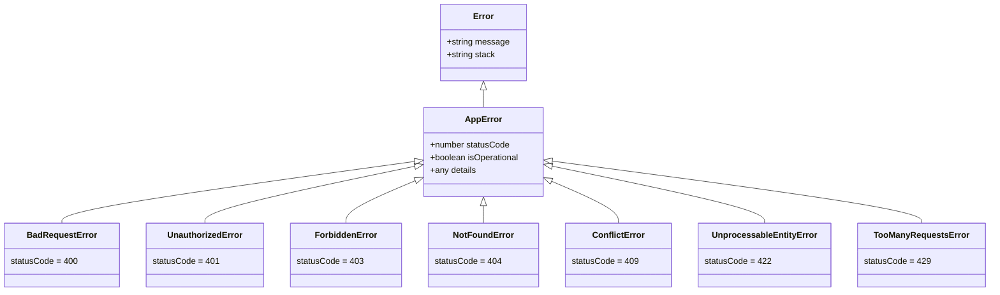

# Errors Directory Documentation (`server/src/shared/errors`)

## A. Directory Overview
The `server/src/shared/errors` directory defines the application-wide error hierarchy. By extending the native JavaScript `Error` class with operational flags, HTTP status codes, and structured metadata, it provides an expressive and standardized mechanism for bubbling failures up through services and controllers into the centralized Express error middleware.

## B. Directory Structure
```text
server/src/shared/errors/
├── errors.md            # This documentation file
└── AppError.js          # Base AppError class and RFC HTTP error subclasses
```

## C. File-by-File Documentation

### 1. `AppError.js`
- **File Type:** JavaScript Module (ESM)
- **Primary Responsibility:** Implements custom error classes mapped to HTTP semantics.
- **Exported Symbols:**
  - `AppError`: Base operational error class (`message`, `statusCode = 500`, `details = null`, `isOperational = true`).
  - `BadRequestError`: HTTP 400 Bad Request.
  - `UnauthorizedError`: HTTP 401 Unauthorized (unauthenticated session or expired credentials).
  - `ForbiddenError`: HTTP 403 Forbidden (authenticated but lacking permissions or ownership).
  - `NotFoundError`: HTTP 404 Not Found.
  - `ConflictError`: HTTP 409 Conflict (e.g., duplicate registration or concurrent update conflict).
  - `UnprocessableEntityError`: HTTP 422 Unprocessable Entity (semantic validation failures).
  - `TooManyRequestsError`: HTTP 429 Rate Limit Exceeded.
  - `InternalServerError`: HTTP 500 Unexpected failure.
- **Dependencies:** Native Node.js `Error` class.
- **Used By:** All modules (`authService`, `eventService`, `registrationService`, `notificationService`, `fileValidation`, `securityMiddleware`, `errorHandler`).
- **Implementation Logic:**
  - Captures V8 stack trace using `Error.captureStackTrace(this, this.constructor)`.
  - Sets `this.isOperational = true` to clearly distinguish known operational domain errors from programmer bugs (e.g. `ReferenceError`, `TypeError`).
- **Security Considerations:** Operational errors are marked safe for user-facing transmission by `errorHandler.js`, while unknown errors mask their internal stack trace in production to prevent information disclosure.

## D. Child Directory Documentation
No child subdirectories exist in this directory.

## E. Internal Relationships


## F. Execution Flow
1. A service or validation check discovers an anomaly (e.g., event sold out or user unauthenticated).
2. It throws an instance of `BadRequestError` or `UnauthorizedError`.
3. The Express controller catches the error and passes it via `next(err)`.
4. The centralized `errorHandler` middleware inspects `err.statusCode` and `err.isOperational`, formatting a standardized JSON response: `{ success: false, error: { message, code, details } }`.

## G. External Dependencies and Integrations
Standard Node.js runtime. No external dependencies.

## H. Important Implementation Notes
- **Distinction of Operational vs Programmer Errors:** If an unhandled programmer bug throws an error without `isOperational = true`, the error handler logs it at `FATAL` level and returns a generic 500 error to the client, preventing internal file path or database credential leakage.

## I. Related Documentation
- [Parent Directory (`server/src/shared/shared.md`)](../shared.md)
- [Error Handler Middleware (`server/src/shared/middleware/middleware.md`)](../middleware/middleware.md)
- [Server Root Documentation (`server/server_root.md`)](../../../server_root.md)

