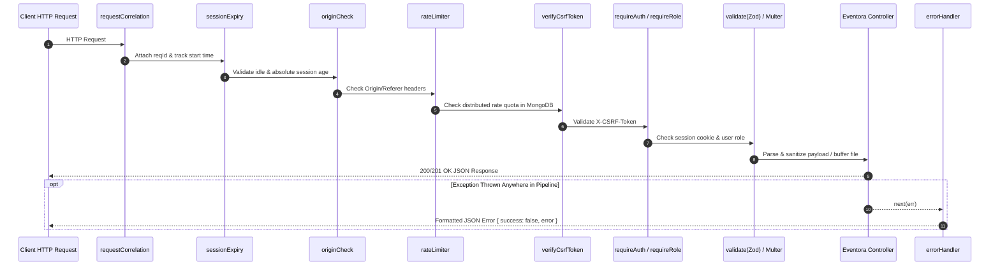

# Middleware Directory Documentation (`server/src/shared/middleware`)

## A. Directory Overview
The `server/src/shared/middleware` directory contains the reusable Express HTTP interceptors that form the security, authorization, error handling, validation, rate limiting, and request correlation pipeline. Every incoming HTTP request passes through these middlewares in a predetermined sequence to guarantee zero-trust protection before controller execution.

## B. Directory Structure
```text
server/src/shared/middleware/
├── middleware.md               # This documentation file
├── authMiddleware.js           # Session authentication & role guards (requireAuth, requireRole)
├── errorHandler.js             # Centralized RFC-compliant JSON error interceptor
├── rateLimiter.js              # Distributed MongoDB-backed rate limiting factories
├── requestCorrelation.js       # UUIDv4 request correlation and duration tracking
├── securityMiddleware.js       # CSRF protection (X-CSRF-Token) and Origin/Referer inspection
├── sessionExpiryMiddleware.js  # Idle and absolute session timeout enforcement
├── uploadMiddleware.js         # Multer in-memory multipart upload handling
└── validate.js                 # Generic Zod schema validation interceptor
```

## C. File-by-File Documentation

### 1. `authMiddleware.js`
- **File Type:** JavaScript Module (ESM)
- **Primary Responsibility:** Enforces session authentication and Role-Based Access Control (RBAC).
- **Exported Symbols:**
  - `authenticate(req, res, next)` (aliased as `requireAuth`): Verifies `req.session?.user?.id` exists. Binds `req.user` and `req.session.userId`. Throws `UnauthorizedError (401)` if absent.
  - `requireRole(...allowedRoles)`: Returns middleware checking `allowedRoles.includes(req.user.role)`. Throws `ForbiddenError (403)` on mismatch.
  - `requireOrganizer`: Convenience middleware for `requireRole(ROLES.ORGANIZER)`.
  - `requireAttendee`: Convenience middleware for `requireRole(ROLES.ATTENDEE)`.
- **Dependencies:** `UnauthorizedError`, `ForbiddenError` from `../errors/AppError.js`, `ROLES` from `../constants/roles.js`.
- **Used By:** `eventRoutes.js`, `registrationRoutes.js`, `notificationRoutes.js`, `authRoutes.js`.
- **Security Considerations:** Guarantees that unauthenticated attendees cannot access organizer rosters or event mutation endpoints, and attendees cannot impersonate organizers.

### 2. `errorHandler.js`
- **File Type:** JavaScript Module (ESM)
- **Primary Responsibility:** 4-argument Express terminal error middleware (`err, req, res, next`).
- **Exported Symbols:**
  - `errorHandler`: Global error interceptor.
- **Dependencies:** `AppError` from `../errors/AppError.js`, `logger` from `../../infrastructure/logging/logger.js`.
- **Used By:** `app.js` (registered as the very last middleware).
- **Implementation Logic:**
  - Identifies `err.isOperational`. If true, respects `err.statusCode` and `err.details`.
  - Normalizes MongoDB duplicate key errors (code `11000`) to HTTP 409 Conflict.
  - Normalizes Mongoose `ValidationError` to HTTP 400 Bad Request.
  - Normalizes Multer errors (`LIMIT_FILE_SIZE`, `LIMIT_UNEXPECTED_FILE`) to HTTP 400 Bad Request.
  - Obfuscates non-operational errors in production (`NODE_ENV === 'production'`) with generic messages to prevent internal stack or path disclosure.
  - Emits structured log entry with `reqId`, `method`, `url`, `userId`, `ip`, and stack trace.

### 3. `rateLimiter.js`
- **File Type:** JavaScript Module (ESM)
- **Primary Responsibility:** Configures distributed rate limiters using MongoDB backing storage (`rate_limits` collection).
- **Exported Symbols:**
  - `createRateLimiter(options)`: Factory creating `express-rate-limit` instance with `MongoRateLimitStore`.
  - `globalRateLimiter`: 100 requests per 15 minutes per IP.
  - `authRateLimiter`: 10 requests per 15 minutes per IP for `/auth/login` and `/auth/register`.
  - `registerEventRateLimiter`: 30 RSVP submissions per 15 minutes per user/IP.
  - `uploadBannerRateLimiter`: 20 image uploads per 15 minutes per organizer/IP.
- **Dependencies:** `express-rate-limit`, `MongoRateLimitStore`, `TooManyRequestsError`, `logger`.
- **Used By:** `app.js`, `authRoutes.js`, `eventRoutes.js`, `registrationRoutes.js`.
- **Security Considerations:** Shared MongoDB store prevents rate-limit evasion across multiple horizontal server instances (e.g., Render autoscaling containers).

### 4. `requestCorrelation.js`
- **File Type:** JavaScript Module (ESM)
- **Primary Responsibility:** Injects unique request identifiers and measures request execution time.
- **Exported Symbols:**
  - `requestCorrelation(req, res, next)`: Reads incoming `X-Request-Id` or generates a cryptographically random UUID via `crypto.randomUUID()`.
- **Dependencies:** Node.js native `crypto`, `logger`.
- **Used By:** `app.js`.
- **Implementation Logic:** Attaches `req.id` to `req` and sets response header `X-Request-Id`. Hooks into response `'finish'` event to log HTTP method, URL, status code, IP, user ID, and elapsed time in milliseconds.

### 5. `securityMiddleware.js`
- **File Type:** JavaScript Module (ESM)
- **Primary Responsibility:** Cross-Origin Resource Sharing (CORS), CSRF synchronizer token verification, and Origin/Referer inspection.
- **Exported Symbols:**
  - `getAllowedOrigins()`: Returns array of trusted frontend domains parsed from `ALLOWED_ORIGINS` environment variable.
  - `getOrCreateCsrfToken(req)`: Returns existing or generates 32-byte hex token stored in `req.session.csrfToken`.
  - `originCheckMiddleware(req, res, next)`: Verifies `Origin` or `Referer` headers match `allowedOrigins` for mutating methods (`POST`, `PUT`, `PATCH`, `DELETE`).
  - `verifyCsrfToken(req, res, next)`: Enforces synchronizer token pattern by verifying `req.headers['x-csrf-token'] === req.session.csrfToken`.
- **Dependencies:** Node.js native `crypto`, `ForbiddenError`, `logger`.
- **Used By:** `app.js`, `authRoutes.js`, `eventRoutes.js`, `registrationRoutes.js`.
- **Security Considerations:** Prevents cross-site request forgery and credentialed cross-origin tampering.

### 6. `sessionExpiryMiddleware.js`
- **File Type:** JavaScript Module (ESM)
- **Primary Responsibility:** Enforces two-tier session lifecycle expiration (idle timeout and absolute max-age).
- **Exported Symbols:**
  - `sessionExpiryMiddleware(req, res, next)`: Checks session creation time and last access time.
- **Dependencies:** `UnauthorizedError`.
- **Used By:** `app.js`.
- **Implementation Logic:**
  - **Idle Timeout (2 Hours):** If `now - req.session.lastAccess > 2 * 60 * 60 * 1000`, destroys session with "Session expired due to inactivity".
  - **Absolute Expiration (24 Hours):** If `now - req.session.createdAt > 24 * 60 * 60 * 1000`, destroys session with "Maximum session duration exceeded".
  - Refreshes `req.session.lastAccess` on active requests.
- **Security Considerations:** Prevents indefinite session hijacking on abandoned terminals.

### 7. `uploadMiddleware.js`
- **File Type:** JavaScript Module (ESM)
- **Primary Responsibility:** Multer middleware handling single-file `multipart/form-data` uploads.
- **Exported Symbols:**
  - `handleBannerUpload(req, res, next)`: Accepts file under field name `file` or `banner` using `multer.memoryStorage()`.
- **Dependencies:** `multer`, `BadRequestError`.
- **Used By:** `eventRoutes.js` (`/events/:eventId/banner`, `/events/banner`).
- **Implementation Logic:**
  - Memory-buffered up to 5MB (`5 * 1024 * 1024` bytes).
  - Normalizes Multer error codes (`LIMIT_FILE_SIZE`, `LIMIT_UNEXPECTED_FILE`) into clean `BadRequestError` instances.
  - Rejects requests containing no file under the expected fields.
- **Security Considerations:** No unvalidated files are written to the server's local file system.

### 8. `validate.js`
- **File Type:** JavaScript Module (ESM)
- **Primary Responsibility:** Higher-order validation middleware wrapping Zod schemas.
- **Exported Symbols:**
  - `validate(schema, target = 'body')`: Middleware generator that executes `schema.safeParse(req[target])`.
- **Dependencies:** `BadRequestError`.
- **Used By:** `authRoutes.js`, `eventRoutes.js`.
- **Implementation Logic:** On validation failure, extracts field paths and error messages, bundling them into `error.details` before passing `BadRequestError (400)` to `next()`. On success, overrides `req[target]` with sanitized, coerced data.

## D. Child Directory Documentation
No child subdirectories exist in this directory.

## E. Internal Relationships


## F. Execution Flow
Request enters via Express -> `requestCorrelation` -> Helmet / CORS -> `sessionExpiryMiddleware` -> `originCheckMiddleware` -> Route-specific `rateLimiter` -> `verifyCsrfToken` -> `requireAuth` / `requireRole` -> `validate` / `handleBannerUpload` -> Domain Controller -> `errorHandler` (if error thrown).

## G. External Dependencies and Integrations
- `express`: Routing and middleware contract.
- `express-rate-limit`: Rate limiting infrastructure.
- `multer`: Multipart parsing.
- `crypto`: Node.js cryptographic primitives.

## H. Important Implementation Notes
- **Zero-Bypass Architecture:** Critical security checks (Origin, CSRF, and Role Guards) cannot be bypassed by client manipulation.
- **Header Standardization:** Adheres to modern RFC headers (`X-Request-Id`, `Retry-After`, `RateLimit-*`).

## I. Related Documentation
- [Parent Directory (`server/src/shared/shared.md`)](../shared.md)
- [Rate Limit Store (`server/src/infrastructure/security/security.md`)](../../infrastructure/security/security.md)
- [Server Root Documentation (`server/server_root.md`)](../../../server_root.md)

