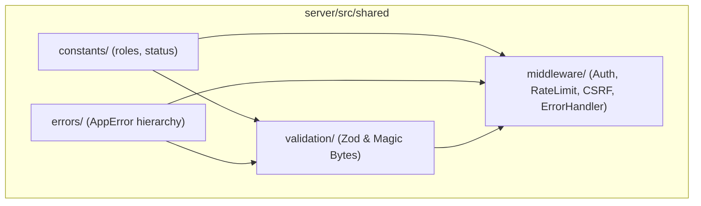

# Shared Kernel Directory Documentation (`server/src/shared`)

## A. Directory Overview
The `server/src/shared` directory represents the Shared Kernel of the Eventora backend application. In alignment with Domain-Driven Design and Vertical Slice Architecture principles, code located in `shared/` contains cross-cutting, domain-agnostic abstractions, domain constants, standardized error models, validation contracts, and Express middleware components consumed by all vertical feature slices (`authentication`, `events`, `registrations`, `notifications`).

## B. Directory Structure
```text
server/src/shared/
├── shared.md            # This documentation file
├── constants/           # Immutable domain enumerations and status objects
│   ├── constants.md     # Constants documentation
│   ├── roles.js         # User role constants (ATTENDEE, ORGANIZER)
│   └── status.js        # Event, Registration, and Notification statuses
├── errors/              # Standardized operational error hierarchy
│   ├── errors.md        # Errors documentation
│   └── AppError.js      # AppError base class and HTTP subclasses
├── middleware/          # Express security, auth, validation, and error interceptors
│   ├── middleware.md    # Middleware documentation
│   ├── authMiddleware.js
│   ├── errorHandler.js
│   ├── rateLimiter.js
│   ├── requestCorrelation.js
│   ├── securityMiddleware.js
│   ├── sessionExpiryMiddleware.js
│   ├── uploadMiddleware.js
│   └── validate.js
└── validation/          # Payload and file validation engines
    ├── validation.md    # Validation documentation
    ├── authValidation.js
    ├── eventValidation.js
    └── fileValidation.js
```

## C. File-by-File Documentation
There are no direct source files in `server/src/shared/`; all logic is organized into the four specialized subdirectories documented below.

## D. Child Directory Documentation

1. **[`constants/`](constants/constants.md)**
   - **Responsibility:** Frozen domain enumerations (`ROLES`, `EVENT_STATUS`, `REGISTRATION_STATUS`, `NOTIFICATION_TYPE`, `NOTIFICATION_CHANNEL`).
   - **Documentation:** [`server/src/shared/constants/constants.md`](constants/constants.md)

2. **[`errors/`](errors/errors.md)**
   - **Responsibility:** Structured error classes extending `Error` with HTTP status codes and operational flags (`BadRequestError`, `UnauthorizedError`, `ForbiddenError`, `NotFoundError`, `ConflictError`, `TooManyRequestsError`).
   - **Documentation:** [`server/src/shared/errors/errors.md`](errors/errors.md)

3. **[`middleware/`](middleware/middleware.md)**
   - **Responsibility:** Request pipeline interceptors enforcing authentication, RBAC, CSRF defense, CORS origin checks, distributed rate limiting, session expiry, multipart file upload buffering, and centralized error handling.
   - **Documentation:** [`server/src/shared/middleware/middleware.md`](middleware/middleware.md)

4. **[`validation/`](validation/validation.md)**
   - **Responsibility:** Declarative Zod validation schemas for request bodies and cryptographic binary magic-bytes validation for image uploads.
   - **Documentation:** [`server/src/shared/validation/validation.md`](validation/validation.md)

## E. Internal Relationships


## F. Execution Flow
Modules across the backend import shared components:
1. Slices define route endpoints protected by `shared/middleware` (e.g., `requireAuth`, `verifyCsrfToken`).
2. Slices validate payloads using `shared/validation` (e.g., `validate(createEventSchema)`).
3. If business constraints fail, slices throw exceptions from `shared/errors` (e.g., `BadRequestError`).
4. `errorHandler.js` catches errors, formatting them into uniform JSON responses.

## G. External Dependencies and Integrations
- `zod`: Schema parsing.
- `express-rate-limit`: Rate limiting engine.
- `multer`: Multipart buffer management.

## H. Important Implementation Notes
- **Strict Independence:** Files in `shared/` must never import from domain feature modules (`server/src/modules/*`), preventing circular dependencies and coupling.

## I. Related Documentation
- [Server Source Root (`server/src/src.md`)](../src.md)
- [Server Root Documentation (`server/server_root.md`)](../../server_root.md)

