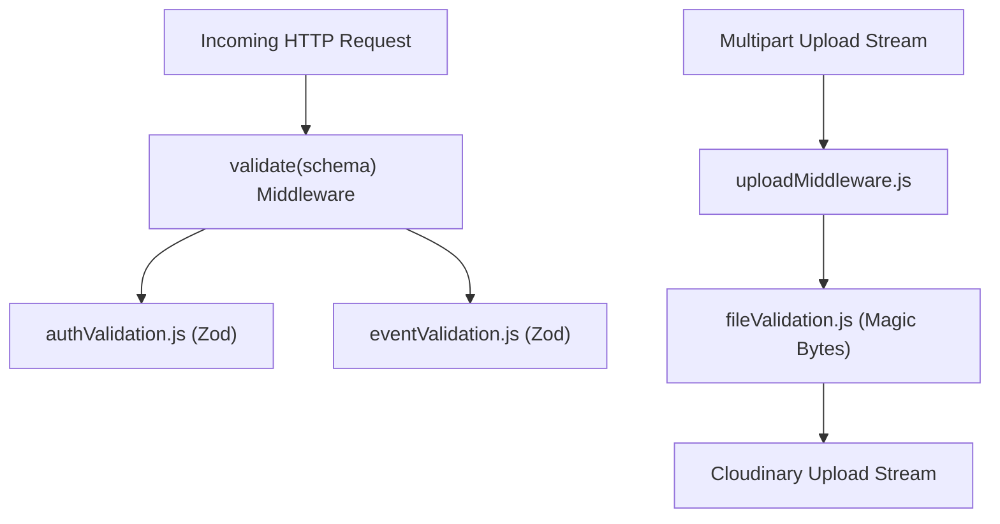

# Validation Directory Documentation (`server/src/shared/validation`)

## A. Directory Overview
The `server/src/shared/validation` directory implements the boundary validation layer of the Express backend. Using Zod schemas for HTTP payloads and low-level binary magic-bytes inspection for uploaded files, it enforces strict type safety, input sanitization, and security constraints before any request reaches service logic or database models.

## B. Directory Structure
```text
server/src/shared/validation/
├── validation.md        # This documentation file
├── authValidation.js    # Registration and login schemas (Zod)
├── eventValidation.js   # Event creation and update schemas (Zod)
└── fileValidation.js    # Binary magic bytes file validation engine
```

## C. File-by-File Documentation

### 1. `authValidation.js`
- **File Type:** JavaScript Module (ESM)
- **Primary Responsibility:** Validates authentication payloads.
- **Exported Symbols:**
  - `registerSchema`: Zod schema validating `name` (2–100 chars, trimmed), `email` (valid RFC format, max 255 chars), `password` (8–128 chars, requires uppercase, lowercase, number, and special character), and `role` (enum: `ATTENDEE` or `ORGANIZER`).
  - `loginSchema`: Zod schema validating `email` and non-empty `password`.
- **Dependencies:** `zod`, `ROLES` from `../constants/roles.js`.
- **Used By:** `authRoutes.js` via the `validate` middleware.
- **Security Considerations:** Enforces strong password complexity at the API gateway level before hashing, mitigating dictionary and brute-force vulnerabilities.

### 2. `eventValidation.js`
- **File Type:** JavaScript Module (ESM)
- **Primary Responsibility:** Validates event creation, update, and search parameters.
- **Exported Symbols:**
  - `eventImageSchema`: Validates `source` (`URL` or `CLOUDINARY`), `url`, and `publicId`.
  - `createEventSchema`: Validates `title` (3–200 chars), `description` (10–5000 chars), `eventDate` (must parse as valid date and be in the future: `val > Date.now()`), `venue` (3–300 chars), `seatLimit` (integer between 1 and 100,000), `category` (optional, max 50 chars), and `bannerUrl` (safe http/https URL).
  - `updateEventSchema`: Partial schema for updating event properties with identical type constraints.
  - `eventQuerySchema`: Validates query parameters (`page`, `limit`, `category`, `search`).
- **Dependencies:** `zod`.
- **Used By:** `eventRoutes.js` via the `validate` middleware.
- **Implementation Logic:** Employs regex validation (`safeUrlRegex`) against Javascript pseudo-protocols (`javascript:`) and enforces strict future-date constraints.

### 3. `fileValidation.js`
- **File Type:** JavaScript Module (ESM)
- **Primary Responsibility:** Low-level binary buffer inspection using cryptographic magic bytes.
- **Exported Symbols:**
  - `ALLOWED_IMAGE_MIME_TYPES`: `['image/jpeg', 'image/png', 'image/webp']`.
  - `MAX_IMAGE_FILE_SIZE`: `5242880` (5MB).
  - `validateImageBuffer(buffer, declaredMimeType)`: Analyzes buffer headers.
- **Dependencies:** `BadRequestError` from `../errors/AppError.js`.
- **Used By:** `eventService.js` (`uploadEventBanner`, `uploadDraftBanner`).
- **Implementation Logic:**
  - Verifies minimum length (12 bytes) and maximum boundary (5MB).
  - Rejects text payloads containing `<svg`, `<?xml`, `<!doctype`, `<html`, or `<script` (mitigating SVG Stored XSS).
  - Detects and rejects Windows PE (`MZ`) and Linux ELF (`\x7fELF`) binaries.
  - Inspects magic bytes:
    - JPEG: `0xFF, 0xD8, 0xFF`
    - PNG: `0x89, 0x50, 0x4E, 0x47, 0x0D, 0x0A, 0x1A, 0x0A`
    - WebP: `RIFF` (bytes 0–3) and `WEBP` (bytes 8–11)
  - Enforces match between declared MIME type and discovered binary signature, rejecting MIME spoofing.
- **Security Considerations:** Guarantees that only valid raster images reach the server-side Cloudinary upload stream.

## D. Child Directory Documentation
No child subdirectories exist in this directory.

## E. Internal Relationships


## F. Execution Flow
1. Request arrives at route with `validate(schema)` middleware attached.
2. Zod parses `req.body` or `req.query`. If validation fails, throws `BadRequestError` with field-level issues.
3. For file uploads, Multer buffers the binary in memory; `fileValidation.js` validates magic bytes in `eventService.js` before dispatching to Cloudinary.

## G. External Dependencies and Integrations
- `zod`: TypeScript-first schema validation.
- Node.js native `Buffer`.

## H. Important Implementation Notes
- **Sanitization via Trimming:** All string schemas include `.trim()` to prevent whitespace padding vulnerabilities.
- **Coercion:** Query parameters and numbers use `z.coerce.number()` to handle string-serialized numbers cleanly.

## I. Related Documentation
- [Parent Directory (`server/src/shared/shared.md`)](../shared.md)
- [Validation Middleware (`server/src/shared/middleware/middleware.md`)](../middleware/middleware.md)
- [Server Root Documentation (`server/server_root.md`)](../../../server_root.md)

