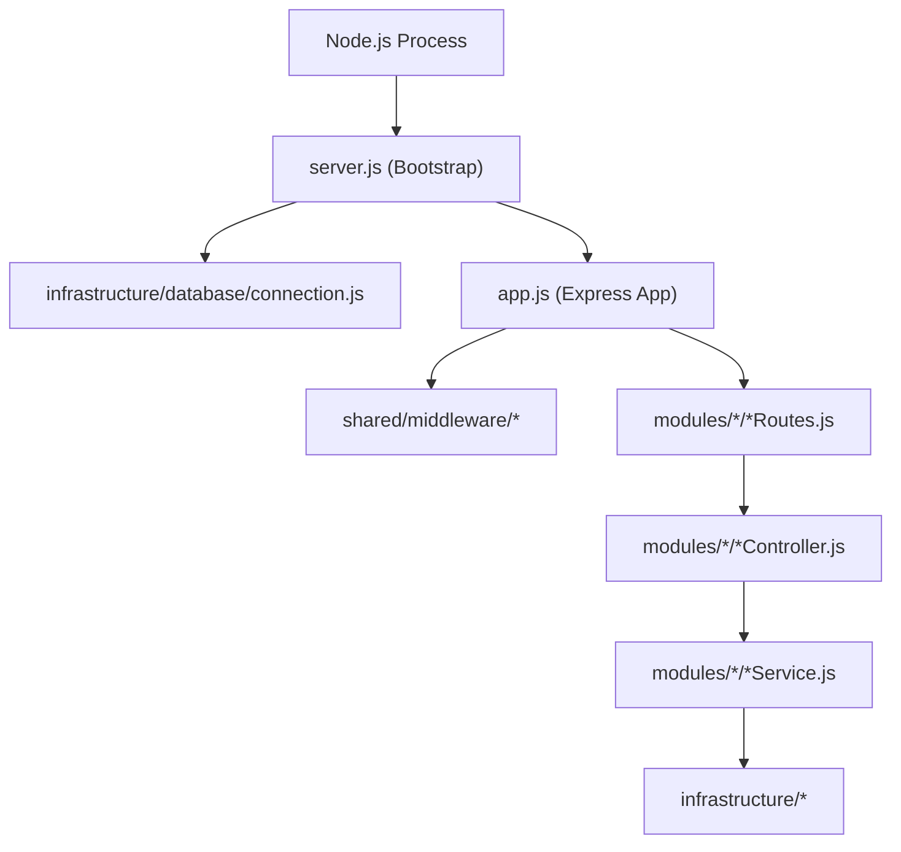

# Server Source Root Documentation (`server/src`)

## A. Directory Overview
The `server/src` directory contains the complete source code for the Eventora Express.js REST API. Operating on Node.js 22 LTS in ECMAScript Modules (ESM) mode, it establishes the application pipeline, bootstraps the server and database connections, and integrates domain feature slices with infrastructure services.

## B. Directory Structure
```text
server/src/
├── src.md               # This documentation file
├── app.js               # Express application initialization and middleware pipeline
├── server.js            # Server entry point, database connection, and graceful shutdown
├── infrastructure/      # Database, session, logging, security, email, and storage clients
│   └── infrastructure.md
├── modules/             # Vertical slice feature modules (auth, events, registrations, notifs)
│   └── modules.md
├── scripts/             # Database seeding and operational scripts
│   └── scripts.md
└── shared/              # Shared kernel (constants, errors, middleware, validation)
    └── shared.md
```

## C. File-by-File Documentation

### 1. `app.js`
- **File Type:** JavaScript Module (ESM)
- **Primary Responsibility:** Express application factory configuring the middleware pipeline and mounting route routers.
- **Exported Symbols:**
  - `default`: Express application instance (`app`).
- **Dependencies:** `express`, `helmet`, `cors`, `cookie-parser`, `dotenv`, auth/event/registration/notification routes, session/security/error middlewares.
- **Used By:** `server.js`, supertest test suites in `tests/`.
- **Pipeline Order:**
  1. `app.set('trust proxy', 1)` — Configured for reverse proxy deployments (Render / Vercel).
  2. `helmet(...)` — Content Security Policy and HTTP security headers.
  3. `cors(...)` — Strict exact-origin matching (`getAllowedOrigins()`) with credentials support.
  4. `cookieParser()` — Cookie parsing.
  5. `createSessionMiddleware()` — MongoDB session persistence.
  6. `requestCorrelation` — UUIDv4 injection and request duration timing.
  7. `sessionExpiryMiddleware` — 30-minute idle and 24-hour absolute session expiration.
  8. `originCheckMiddleware` — Origin/Referer inspection on mutating requests.
  9. `globalRateLimiter` — Distributed MongoDB rate limiter.
  10. Health check endpoint: `GET /api/v1/health` and `GET /health`.
  11. Route mounts:
      - `/api/v1/auth` -> `authRoutes`
      - `/api/v1/events` -> `eventRoutes`
      - `/api/v1/notifications` -> `notificationRoutes`
      - `/api/v1` -> `registrationRoutes`
  12. 404 Catch-All: Returns `NotFoundError (404)`.
  13. Centralized `errorHandler`: RFC-compliant JSON error formatting.

### 2. `server.js`
- **File Type:** JavaScript Module (ESM)
- **Primary Responsibility:** Node.js process entry point and lifecycle manager.
- **Exported Symbols:** None (executable script).
- **Dependencies:** `dotenv`, `./app.js`, `connection.js`, `logger.js`.
- **Used By:** `npm start` (Render production), `npm run dev` (Nodemon development).
- **Implementation Logic:**
  - Loads environment variables via `dotenv.config()`.
  - Resolves `PORT` (default: 5000).
  - Connects to MongoDB Atlas via `connectDatabase(mongoUri)`.
  - Boots HTTP listener via `app.listen()`.
  - Registers graceful shutdown hooks for `SIGTERM` and `SIGINT`:
    - Closes HTTP server to stop accepting new traffic.
    - Disconnects MongoDB connection pool cleanly.
    - Enforces a 10-second watchdog timer to terminate hung processes.

## D. Child Directory Documentation

1. **[`infrastructure/`](infrastructure/infrastructure.md)**
   - External clients, database connection, session store, Pino logger, Resend email client, and Cloudinary SDK.
   - [Documentation](infrastructure/infrastructure.md)

2. **[`modules/`](modules/modules.md)**
   - Vertical feature slices: `authentication`, `events`, `registrations`, `notifications`, `users`, `audit`.
   - [Documentation](modules/modules.md)

3. **[`scripts/`](scripts/scripts.md)**
   - Developer tooling and database seeder (`seed.js`).
   - [Documentation](scripts/scripts.md)

4. **[`shared/`](shared/shared.md)**
   - Shared kernel: `constants`, `errors`, `middleware`, `validation`.
   - [Documentation](shared/shared.md)

## E. Internal Relationships


## F. Execution Flow
`node src/server.js` -> `connectDatabase()` -> `app.listen()` -> HTTP Request received -> Pipeline in `app.js` executes -> Dispatched to feature route -> Handled by controller/service -> Response returned.

## G. External Dependencies and Integrations
- `express`: Core framework.
- `mongoose`: Database ODM.
- `helmet`: Security headers.
- `cors`: Cross-origin permissions.

## H. Important Implementation Notes
- **Separation of App and Server:** Decoupling `app.js` from `server.js` allows unit and integration test suites to import `app` directly into Supertest without starting network sockets or port bindings.

## I. Related Documentation
- [Server Root Documentation (`server/server_root.md`)](../server_root.md)
- [Root Project README (`README.md`)](../../README.md)

